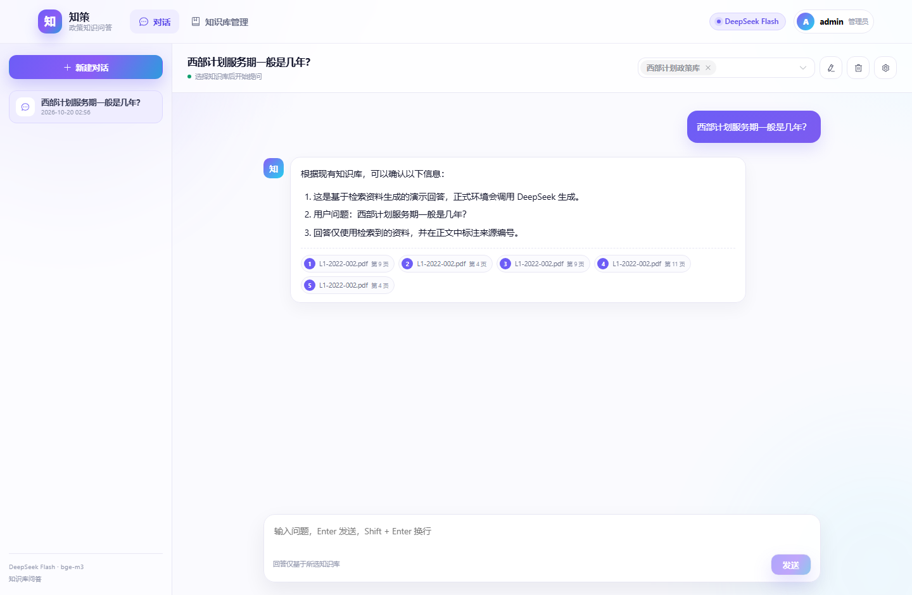
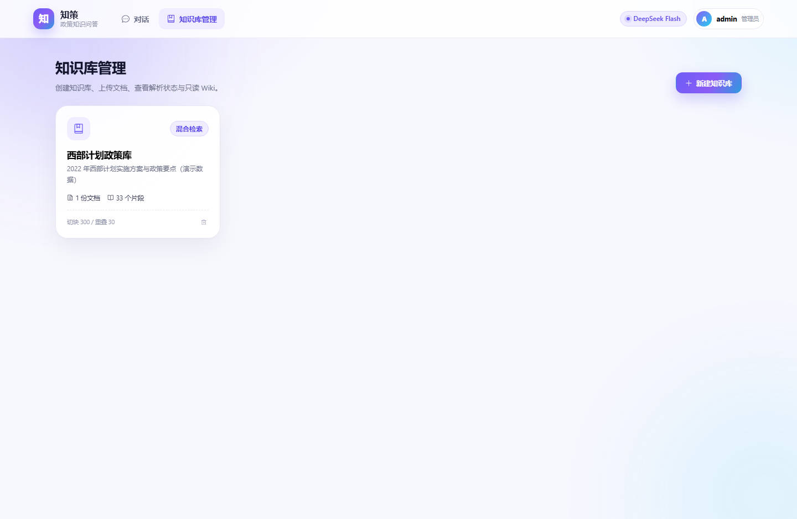
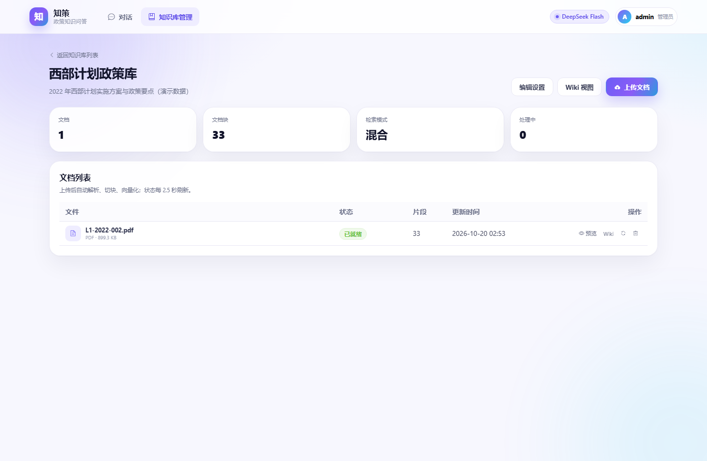
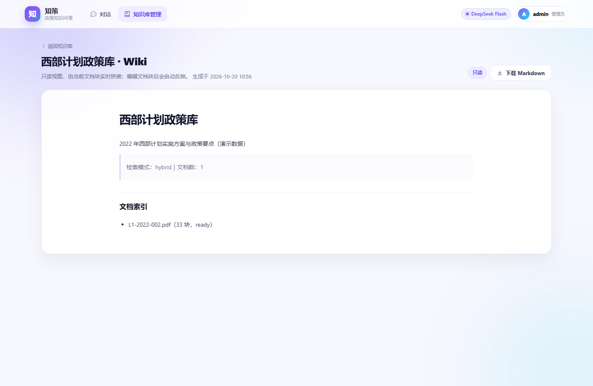

# enterprise-rag · 知策

> 基于企业/政策内容知识库的 RAG 问答系统。
> 技术栈：Vue 3 + FastAPI + MySQL + Milvus + 本地 bge-m3 + DeepSeek `deepseek-flash`。

---

## 一、项目定位

面向“资料分散、版本多、需要可核验引用”的政策/企业知识场景：

- **管理员**维护知识库、上传文档、查看解析状态、编辑文档块、浏览只读 Wiki。
- **普通用户**注册/登录后，选择一个或多个知识库提问，获得流式回答与来源引用。
- 会话按用户隔离；普通用户不能修改知识库内容。

当前样例语料为西部计划政策文档，系统本身支持任意企业文档。

---

## 二、当前完成度

- [x] 登录 / 注册 / 图形验证码 / JWT / 角色权限
- [x] 知识库 CRUD、文档上传、PDF/PPTX/Markdown/图片/DOCX 解析
- [x] 切块、bge-m3 编码、Milvus 稠密 + BM25 混合检索
- [x] DeepSeek 流式问答、历史轮数、温度 / Top P / max_tokens 参数
- [x] 会话新建 / 重命名 / 删除、用户隔离
- [x] 文档块预览 / 编辑 / 删除、文档 / 知识库删除
- [x] 只读 Wiki 视图（文档 Wiki、知识库 Wiki、Markdown 下载）
- [x] 控制台 + 文件日志、请求 ID、健康检查、OpenAPI
- [x] pytest 单元测试、Vitest 前端测试、Playwright E2E

---

## 三、业务流程图


三条泳道：**用户入口与权限 → 在线 RAG 问答 → 离线知识库**。详细说明与 Mermaid 可编辑版见 [`docs/05-业务流程图.md`](docs/05-业务流程图.md)。

---

## 四、快速开始

### 1. 依赖

- Docker Desktop
- Python 3.13+（仓库使用 uv 管理）
- Node.js 22+ / npm

### 2. 启动基础设施

```powershell
cd D:\WorkSpace\deepseek\projects\enterprise-rag
docker compose up -d
docker compose ps
```

服务：

| 服务 | 端口 |
|---|---|
| MySQL 8.0 | 3306 |
| Milvus 2.6.24 | 19530（健康检查 9091） |
| MinIO | 9000 / 9001 |
| etcd | 容器内 2379 |

> 本机若已有 MySQL/Milvus，可修改 `.env` 连接串与 `MILVUS_URI`，不启动对应 compose 服务。当前 compose 使用本机已有的 MySQL 8.0.43 镜像。

### 3. 配置

```powershell
Copy-Item .env.example .env
```

至少修改：

```ini
JWT_SECRET=换成一个足够长的随机字符串
ADMIN_PASSWORD=换成一个至少 8 位的管理员密码
DEEPSEEK_API_KEY=你的 DeepSeek API Key
```

bge-m3 默认从 HuggingFace 下载；国内网络可取消 `.env` 中 `HF_ENDPOINT=https://hf-mirror.com` 的注释，或把 `EMBEDDING_MODEL` 指向本地模型目录。

### 4. 初始化数据库与管理员

```powershell
uv sync
uv run python scripts/init_db.py
uv run python scripts/create_admin.py
```

### 5. 首次下载 bge-m3（可选但推荐）

```powershell
uv run python scripts/preload_embedder.py
```

模型约 2.2 GB，缓存到 `data/models/`。首次会较慢；之后启动可直接使用。

### 6. 启动后端

```powershell
uv run uvicorn enterprise_rag.main:app --reload --port 8001
```

- 健康检查：<http://127.0.0.1:8001/health>
- API 文档：<http://127.0.0.1:8001/docs>

### 7. 启动前端

```powershell
cd frontend
npm install
npm run dev
```

打开 <http://127.0.0.1:5174>。

默认管理员账号由 `.env` 的 `ADMIN_USERNAME` / `ADMIN_PASSWORD` 决定。

---

## 五、界面预览

| 登录 | 对话 |
|---|---|
|  |  |

| 知识库管理 | 知识库详情 |
|---|---|
|  |  |

| 只读 Wiki | 注册 |
|---|---|
|  |  |

---

## 六、测试

### 后端单元测试

```powershell
uv run pytest tests/ -v
```

### 真实 MySQL + Milvus 集成测试

先创建测试库：

```powershell
docker exec enterprise-rag-mysql mysql -uroot -proot123456 -e "CREATE DATABASE IF NOT EXISTS enterprise_rag_test CHARACTER SET utf8mb4 COLLATE utf8mb4_unicode_ci; GRANT ALL PRIVILEGES ON enterprise_rag_test.* TO 'rag'@'%'; FLUSH PRIVILEGES;"
```

然后：

```powershell
$env:RUN_INTEGRATION='1'
uv run pytest -m integration -v
```

### 真实 bge-m3 / DeepSeek

```powershell
$env:RUN_BGE_M3='1'
uv run pytest -m bge_m3 -v

$env:RUN_DEEPSEEK='1'
$env:DEEPSEEK_API_KEY='你的 Key'
uv run pytest -m deepseek -v
```

### 前端

```powershell
cd frontend
npm run typecheck
npm run test
npm run build
```

### Playwright E2E

E2E 使用独立数据库 `enterprise_rag_e2e` 与 Milvus 集合 `kb_chunks_e2e`，默认使用 hash embedder + mock LLM，不消耗真实模型额度。

```powershell
docker exec enterprise-rag-mysql mysql -uroot -proot123456 -e "CREATE DATABASE IF NOT EXISTS enterprise_rag_e2e CHARACTER SET utf8mb4 COLLATE utf8mb4_unicode_ci; GRANT ALL PRIVILEGES ON enterprise_rag_e2e.* TO 'rag'@'%'; FLUSH PRIVILEGES;"
cd frontend
npx playwright install chromium
npx playwright test
```

覆盖：管理员建库 → 上传 → 解析 → 预览 → 编辑 → Wiki；普通用户注册 → 问答 → 引用 → 会话重命名 → 删除；权限拦截。

---

## 七、模型与参数说明

### bge-m3

- 本地 `sentence-transformers` 加载 `BAAI/bge-m3`，输出 1024 维归一化向量。
- 自动检测 CUDA，6GB 显存下建议 `EMBEDDING_MAX_LENGTH=1024`、`EMBEDDING_BATCH_SIZE=8`；OOM 自动回退 CPU。
- 当前 `uv sync` 默认安装 CPU 版 torch；如需 GPU，请按 PyTorch 官网安装对应 CUDA 版 torch，代码会自动检测。
- 混合检索 = bge-m3 稠密向量 + Milvus BM25 稀疏向量，RRF 融合。
- v1 不启用 bge-m3 的 sparse / ColBERT 输出。

### DeepSeek

- 固定 `deepseek-flash`，前端不提供模型选择。
- 显式 `thinking={"type":"disabled"}`，使温度参数生效。
- DeepSeek 官方文档说明：非思考模式下 `top_p` 固定为 1.0，传入值会被忽略；界面保留 Top P 控件并标注该限制。
- 历史轮数默认 5，可在对话参数面板调整（0–20）。
- 最长输出 token 默认 2048（128–8192）。

---

## 八、目录结构

```text
enterprise-rag/
├── src/enterprise_rag/
│   ├── api/              薄路由
│   ├── services/         认证、知识库、入库、检索、问答、Wiki
│   ├── ingest/           PDF/PPTX/MD/图片/DOCX 解析与切块
│   ├── infra/            MySQL、Milvus、bge-m3、DeepSeek、OCR
│   └── main.py           应用入口
├── tests/                pytest 单元 / 集成测试
├── frontend/             Vue 3 + Vite + Element Plus
├── data/samples/         可复现测试样例
├── data/uploads/         上传文件（不进 git）
├── data/models/          bge-m3 缓存（不进 git）
├── docs/                 需求、架构、接口、测试文档
└── docker-compose.yml    MySQL + etcd + MinIO + Milvus
```

---

## 九、常见问题

**bge-m3 下载很慢/失败**
把 `HF_ENDPOINT` 设为 `https://hf-mirror.com`，或下载到本地目录后设置 `EMBEDDING_MODEL=D:\models\bge-m3`。

**没有 DeepSeek Key 能不能跑？**
可以跑单元测试和 E2E（`LLM_PROVIDER=mock`）；真实问答需要 Key。未配置时健康检查显示 `unconfigured`，问答返回中文错误提示。

**上传 `.ppt` 失败**
v1 支持 `.pptx`，不支持旧 `.ppt`；请先另存为 `.pptx`。

**Milvus 启动慢**
首次启动约 60–90 秒；`docker compose ps` 看到 `healthy` 后再启动后端。

**端口冲突**
后端 8001、前端 5174；MySQL 3306、Milvus 19530 可按需在 compose 与 `.env` 中修改。

---

## 十、文档

| 文档 | 内容 |
|---|---|
| [`docs/01-需求与范围.md`](docs/01-需求与范围.md) | 原始需求映射、角色、范围、验收 |
| [`docs/02-架构与数据模型.md`](docs/02-架构与数据模型.md) | 分层、数据流、MySQL/Milvus 模型 |
| [`docs/03-接口与SSE契约.md`](docs/03-接口与SSE契约.md) | API、SSE 事件、错误码 |
| [`docs/04-测试与验收.md`](docs/04-测试与验收.md) | 测试矩阵、命令、验收清单 |
| [`docs/05-业务流程图.md`](docs/05-业务流程图.md) | 三泳道流程图、输入到输出、与参考图对照 |
| [`docs/06-全链路技术详解.md`](docs/06-全链路技术详解.md) | 每个环节的技术、作用、输入输出、实现与失败处理 |
| [`frontend/README.md`](frontend/README.md) | 前端启动、页面、E2E 说明 |


