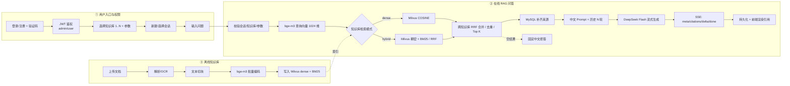

# 05 · 业务流程图

> 版本 v1.0｜日期：2026-10-20
> 对照参考图的三条泳道：**用户入口与权限 → 在线 RAG 问答 → 离线知识库**。
> 图片：[`diagrams/enterprise-rag-flow.png`](diagrams/enterprise-rag-flow.png)（源文件 [`diagrams/flow.html`](diagrams/flow.html)）
> 每个环节的技术细节见 [`06-全链路技术详解.md`](06-全链路技术详解.md)。


---

## 1. 从输入到输出（主链路）

```text
用户输入
  → 登录/注册（图形验证码）
  → JWT 鉴权（admin / user）
  → 选择 1..N 个知识库 + 推理参数 + 会话
  → 提交问题
  → 校验会话归属 / 知识库存在 / 参数范围
  → bge-m3 编码查询（1024 维）
  → 按知识库 retrieval_mode 分流
       ├── dense：Milvus COSINE
       └── hybrid：Milvus 稠密 + BM25 → RRF
  → 跨知识库 RRF 合并 / 按 chunk_id 去重 / Top K（默认 5）
  → MySQL 补齐来源（文件名 / 知识库 / 页码 / 片段）
  → 组装中文 Prompt（系统规则 + 历史 N 轮 + 参考资料 + 当前问题）
  → DeepSeek Flash 流式生成（非思考模式）
  → SSE：meta → citations → delta… → done
  → 持久化 user/assistant 消息、引用、usage
  → 前端渲染：答案 + 引用卡片 + 来源抽屉

空结果：不调用 LLM，直接返回固定中文拒答，并写入消息记录。
```

### 输入

- 用户：账号、密码、验证码；所选知识库；温度、Top P、max_tokens、历史轮数；问题文本。
- 管理员：文档文件、切块大小/重叠、检索模式。

### 输出

- 流式中文回答。
- 每条结论的来源引用（所在文件、知识库、页码、原文片段）。
- 持久化的会话消息与引用。
- 管理端：文档解析状态、文档块、只读 Wiki。

---

## 2. 三条泳道

### ① 用户入口与权限

```text
登录 / 注册（验证码）
  → JWT 鉴权（role=admin/user）
  → 选择知识库（1..N，至少 1 个）
  → 设置推理参数（温度 / Top P / max_tokens / 历史轮数）
  → 新建或选择会话（按 user_id 隔离）
  → 输入问题
```

### ② 在线 RAG 问答

```text
问题校验
  → bge-m3 查询向量
  → 按知识库检索模式分流
       ├── 稠密检索：Milvus COSINE，按 kb_id 过滤
       └── 混合检索：Milvus 稠密 + BM25，RRF 融合
  → 跨知识库 RRF 合并 / 去重 / Top K
  → MySQL 补齐来源
  → 中文 Prompt（规则 + 历史 + 资料 + 问题）
  → DeepSeek Flash 流式生成
  → SSE 事件流
  → 持久化 + 前端渲染
```

### ③ 离线知识库（管理员）

```text
上传文档（PDF / PPTX / MD / PNG / JPG / DOCX）
  → 解析 / OCR
  → 文本切块（chunk_size / overlap / 页码）
  → bge-m3 批量编码（1024 维）
  → 写入 Milvus（dense + BM25 sparse）
  → 状态：pending → parsing → chunking → embedding → indexing → ready
  → 文档块预览 / 编辑 / 删除
  → 只读 Wiki（实时由文档块组装）
```

---

## 3. 与参考图的逐项对照

| 参考图模块 | 当前实现 | 说明 |
|---|---|---|
| MySQL 问答 / Redis 缓存 | ❌ 未实现 | 当前所有问题直接走 RAG；后续可加高频问答缓存 |
| 高频问答统计 | ❌ 未实现 | 可基于 `chat_messages` 统计后加缓存 |
| BM25 命中阈值 / 直接回答 | ❌ 未实现 | 当前 BM25 只作为混合检索的一路 |
| 意图识别（BERT/LLM） | ❌ 未实现 | 当前统一走 RAG；空检索时拒答 |
| 多查询 / 子问题 / 假设文档检索 | ❌ 未实现 | 当前单查询；多知识库用 RRF 合并 |
| 检索策略选择器 | ⚠️ 简化 | 由知识库 `retrieval_mode` 决定 dense/hybrid |
| Milvus 向量检索 | ✅ 已实现 | 稠密 + BM25 稀疏 |
| Reranker 重排 | ❌ 未实现 | 当前 RRF 后直接取 Top K |
| 父文档去重 / TopK 上下文 | ⚠️ 简化 | 当前按 chunk_id 去重；无父子文档 |
| LLM 生成 | ✅ 已实现 | 固定 `deepseek-flash`，流式 |
| 引用 / 来源 | ✅ 已实现 | 文件名、知识库、页码、片段、相关度 |
| 离线 LangChain 预处理 | ⚠️ 替代 | 自研解析 + 切块（PyMuPDF/RapidOCR/python-pptx/python-docx） |
| 文档分块 / 子块 | ✅ 已实现 | 字符级 chunk_size / overlap |
| bge-m3 混合编码 | ✅ 已实现 | 本地 1024 维 dense；BM25 由 Milvus 提供 |
| 用户 / 权限 | ✅ 已实现 | JWT + admin/user + 会话隔离 |
| 会话 / 历史 | ✅ 已实现 | 历史轮数默认 5，可配 |
| Wiki | ✅ 已实现（只读） | 参考图没有；由文档块实时组装 |

---

## 4. Mermaid 版（可编辑）



---

## 5. 一句话总结

参考图是“**FAQ 缓存 + 意图识别 + 多路查询 + reranker + 父子文档**”的重型 RAG；当前实现是“**离线解析入库 + bge-m3/Milvus 混合召回 + 中文 Prompt + DeepSeek 流式 + 引用**”的精简版主干。两者主链路一致：**输入 → 召回 → 重排/融合 → 上下文 → 生成 → 引用**；差异主要在召回前后的增强模块，后续可按同一主干逐步插入。
